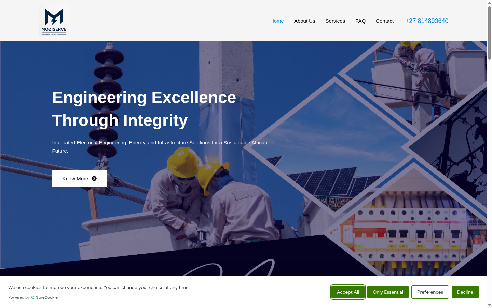
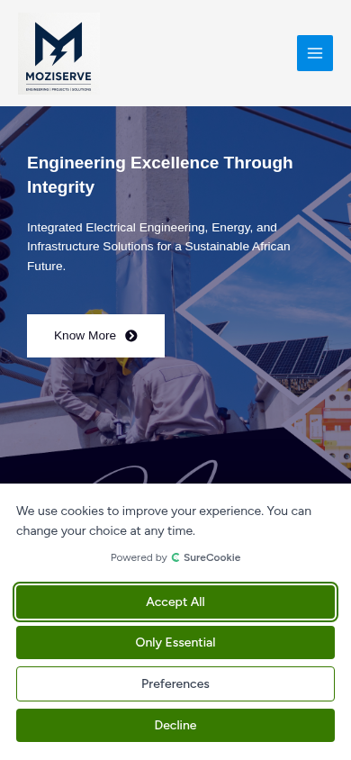

# Aesthetics Review

Source captured on 2026-11-15. The original screenshots and colour register are ready for review. Annotated component proposals and user feedback are pending. [Source capture manifest](evidence/2026-11-15/manifest.md)

## Original homepage

| Desktop · 1440 × 900 | Mobile · 390 × 844 |
| --- | --- |
|  |  |

Both views show the first-visit cookie banner and the initial viewport. The mobile header uses a blue menu button in place of the desktop link row. Both use the same logo, white hero heading and button, and a dark overlay over the engineering image. The mobile image is cropped more tightly and the banner occupies about the lower third of the capture.

The rendered header logo has a companion [1998 × 1998 source PNG](evidence/2026-11-15/header-logo-2x.png). The site also declares a [separate icon](evidence/2026-11-15/site-icon-192.png). The image's current homepage alternative text is unrelated to the logo. The asset can remain while its text alternative is corrected during the rebuild. [Logo provenance](evidence/2026-11-15/manifest.md)

## Exact homepage colours

The table uses CSS declarations and Chromium computed styles from the original page. The hex values for computed RGB colours are exact conversions. Logo and photo pixels were excluded from the CSS register.

| Value | Observed use or declaration | Evidence |
| --- | --- | --- |
| `#0089E4` | Active navigation, header phone display, Services button and form submit background | Computed `rgb(0, 137, 228)` and Astra `--ast-global-color-0` |
| `#192730` | Body text | Computed `rgb(25, 39, 48)` and Astra `--ast-global-color-1` and `-3` |
| `#000000` | Inactive desktop navigation | Computed `rgb(0, 0, 0)` and Astra `--ast-global-color-2`, `-7`, and `-8` |
| `rgba(241, 241, 241, 0.71)` | Header background | Homepage self-hosted inline Astra CSS, `.ast-primary-header-bar` |
| `#FFFFFF` | Body background, hero heading, hero button surface, and blue button text | Computed `rgb(255, 255, 255)` and Astra `--ast-global-color-5` |
| `#F6F6F8` | Market segments surface | Computed `rgb(246, 246, 248)` on `.elementor-element-9f17186` and Astra `--ast-global-color-4` |
| `#ECEDEF` | Declared alternate background | Astra `--ast-global-color-6`; specific visible assignment unconfirmed |
| `#0A013E` at opacity `0.53` | Hero photo overlay | Elementor `.elementor-element-6721d7b::before` and `--overlay-opacity` |
| `#0C091D` | Hero button text and dark contact panel background | Computed `rgb(12, 9, 29)` on the hero button and `.elementor-element-24a0ed0` |
| `#F5F5F5` | Vision heading | Computed `rgb(245, 245, 245)` on the Vision heading |
| `#1A3446` | Footer background | Computed `rgb(26, 52, 70)` and inline Astra `.site-footer` |
| `#377A00`, `#2F6A00`, `#374151`, `#FFFFFF` | Cookie banner button, declared hover, body text, and surface respectively | Homepage `surecookie-public-inline-css` |

The Elementor kit separately declares `#6EC1E4`, `#54595F`, `#7A7A7A`, and `#61CE70` as its primary, secondary, text, and accent defaults. These were read from computed custom properties. Their roles in the sampled homepage components are unconfirmed. [Homepage](https://moziserve.co.za/) · [Elementor page CSS](https://moziserve.co.za/wp-content/uploads/elementor/css/post-1361.css?ver=1793678323) · [Elementor kit CSS](https://moziserve.co.za/wp-content/uploads/elementor/css/post-1182.css?ver=1793678323)

## Review scope

- The homepage body and hero heading compute to Montserrat with a sans-serif fallback.
- Desktop captures are also available for [About Us](evidence/2026-11-15/about-us-desktop.png), [Services](evidence/2026-11-15/services-desktop.png), [FAQ](evidence/2026-11-15/faq-desktop.png), and [Contact](evidence/2026-11-15/contact-desktop.png).
- The register covers sampled homepage components and directly related source rules. Other pages, interaction states, and contrast still need review before token mapping or implementation.
- Prepare annotated treatments for the header, hero, services, contact, and footer. Component implementation follows user inspection of the direction.
